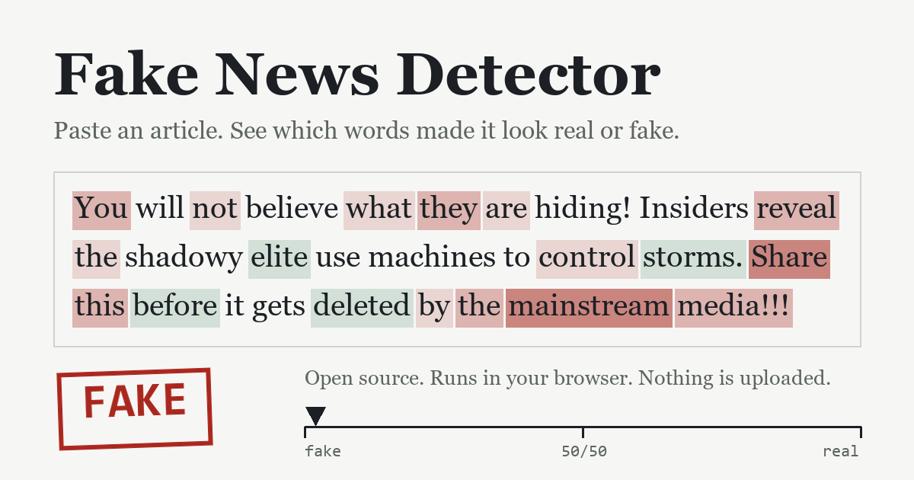

# Fake News Detector

[](https://github.com/gorintlapavanprasad/fake-news-detection/actions/workflows/ci.yml)
[](LICENSE)
[](https://gorintlapavanprasad.github.io/fake-news-detection/)

**An open-source fake news classifier that runs entirely in your browser and shows which words drove each decision.**



**[Try the live demo](https://gorintlapavanprasad.github.io/fake-news-detection/)**. Paste an article, get REAL or FAKE, and see the evidence words marked in red and green inside your own text. Nothing is uploaded and no API keys are used.

Keywords: fake news detection, misinformation, NLP, text classification, TF-IDF, logistic regression, DistilBERT, explainable AI, GitHub Pages, JavaScript, Python, scikit-learn.

## What is different here

Most fake-news repos report 99% on one dataset and stop. This project measures what happens on data the model has not seen, and says so.

The model is trained on five sources: ISOT (Reuters vs. fake-news sites), WELFake (mixed outlets, overlap with ISOT removed), GossipCop (celebrity news), PolitiFact (fact-checked politics, only 277 articles) and COVID-19 claims and tweets.

| Source | Held-out articles (source seen in training) | Source left out of training entirely |
|---|---|---|
| ISOT | 94.3% | 64.8% |
| WELFake | 86.9% | 47.4% |
| GossipCop | 76.2% | 44.0% |
| PolitiFact | 69.6% (56 articles) | 66.1% |
| COVID-19 | 86.2% | 46.1% |

The right-hand column comes from leave-one-source-out training (`improved/loso_eval.py`). Four of the five scores are at or below what always guessing the bigger class would give (53% to 67%, depending on the source). The honest reading: this is a writing-style classifier, and each dataset defines "fake" differently, so a style learned from one source does not carry over to another.

What else I measured:
- **Giveaways in the original data.** "(Reuters)" datelines and outlet tags let a model score about 99% without learning anything about truth. They are stripped before training.
- **Warning signals.** I tried to detect when a text is outside the model's experience. Model confidence and the share of known words do not predict mistakes (AUROC about 0.5). Similarity to each source's centroid separated the COVID tweets (0.88) and partly WELFake (0.61), but did worse than chance for ISOT, GossipCop and PolitiFact (`improved/ood_eval.py`). None of these is shipped, so the site cannot warn you; it states the limit instead.
- **DistilBERT.** Fine-tuned on 3,000 articles for one epoch on a CPU: 95.6% on ISOT and 84.1% on WELFake (800 held-out articles each). It did not beat TF-IDF under that budget, and at about 270 MB it cannot ship in a static site.
- **Trade-off.** Training on five sources lowered accuracy on the original two (ISOT 97.1% to 94.3% for the earlier two-source model).
## How it works

```
article text -> clean (strip links, digits, source giveaways)
             -> TF-IDF over 30,000 words and word pairs
             -> logistic regression -> probability of REAL
             -> per-word contributions -> highlighted evidence
```

The same arithmetic is implemented twice: in Python (`improved/`) for training and in JavaScript (`docs/engine.js`) for the website. `tests/test_parity.mjs` feeds both the same texts and requires agreement within 0.001 (measured worst gap: 2e-6). `tests/eval_js_engine.mjs` scores the JavaScript engine on 1,000 held-out articles per source and requires its accuracy to match Python's.

## Run it

Website (no build step):
```bash
cd docs && python -m http.server 8000     # open http://localhost:8000
```

Retrain from scratch:
```bash
pip install -r requirements-dev.txt
# put Fake.csv and True.csv (Kaggle "Fake and Real News", ISOT) in Prototype/data/raw/
cd improved
python run_experiments.py --data ../Prototype/data/raw      # 16 model/feature variations
python prepare_external.py --isot ../Prototype/data/raw     # clean WELFake (needs the HF files, see Data sources)
python loso_eval.py --isot ../Prototype/data/raw --ext external   # leave-one-source-out\npython export_web.py --isot ../Prototype/data/raw --ext external
```

Tests:
```bash
pytest tests
node tests/test_parity.mjs
node tests/test_engine_robustness.mjs
```

Data sources: ISOT from [Kaggle](https://www.kaggle.com/datasets/emineyetm/fake-news-detection-datasets); WELFake (`davanstrien/WELFake`) and GossipCop (`Jinyan1/GossipCop`) from Hugging Face. Check each dataset's license before redistributing it. The repo stores no datasets, only a 25-article sample (`docs/parity.json`) used to test the browser engine.

## Repository layout

| Path | What it holds |
|---|---|
| `docs/` | The static website served by GitHub Pages, its model file and the design notes |
| `improved/` | Cleaning code, experiments, external-data preparation, DistilBERT fine-tuning, Flask demo |
| `tests/` | Python unit tests and Node tests for the browser engine |
| `Prototype/` | Original PyTorch BiLSTM + attention model (config-driven) |
| `main.py`, `FND_using_*.py` | Original TensorFlow hybrid and classical scripts, now runnable locally |
| `PROJECT_REPORT.md` | Full analysis, 16-experiment table, problems found, roadmap |

## Limits

It scores writing style learned from mostly English, US-politics articles from 2016 and 2017. It cannot verify facts, and it is unreliable on satire, opinion, other languages and unfamiliar topics such as entertainment news. Use it as a prompt to look closer, never as a verdict.

## Roadmap

1. Add evidence retrieval (search or fact-check APIs) so claims, not only style, are checked. This needs a server and keys, so it cannot live on GitHub Pages.
2. Fine-tune DistilBERT on the full data with a GPU and compare on the leave-one-source-out tests.
3. Find a reliable way to detect text outside the model's experience; the simple signals tried so far do not work.

## Contributing and license

See [CONTRIBUTING.md](CONTRIBUTING.md) and [CODE_OF_CONDUCT.md](CODE_OF_CONDUCT.md). Released under the [MIT license](LICENSE). Cite via [CITATION.cff](CITATION.cff).

Authors: Pavan Gorintla, Smirthya Somaskantha Iyer, Rahul Rubugunday.
